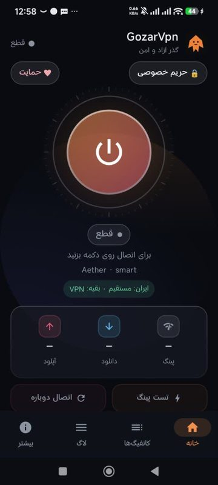
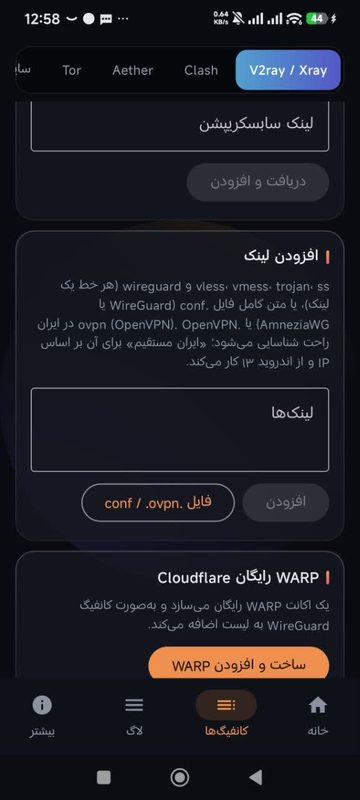
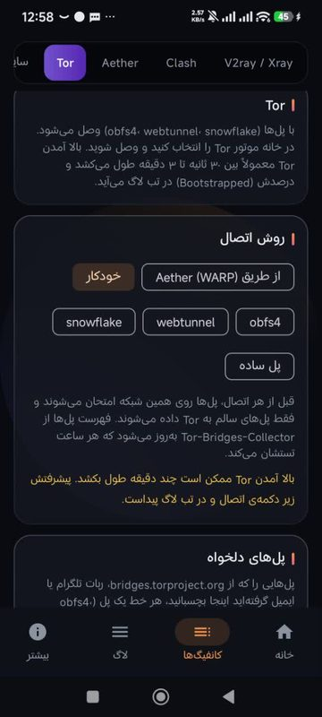
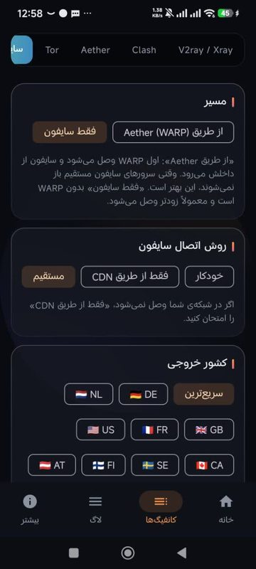
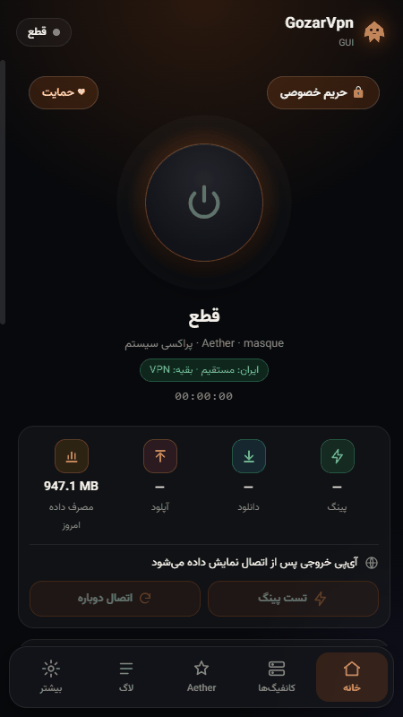
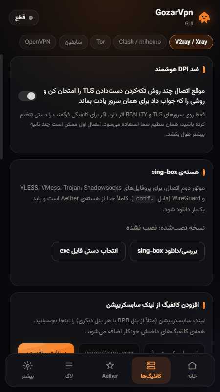
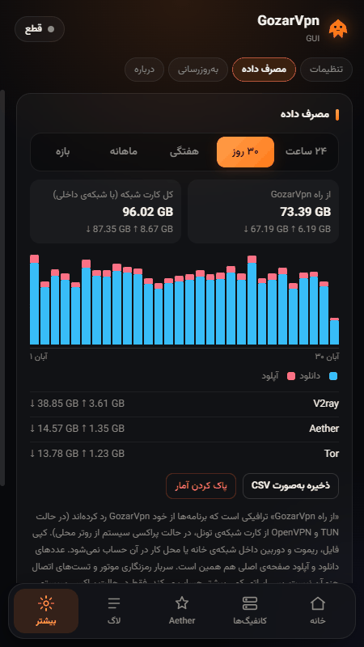
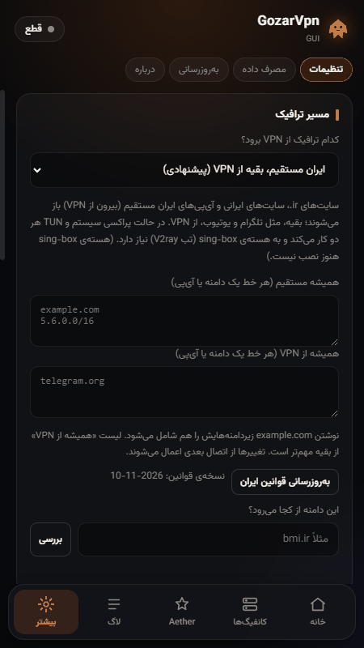

# گذر (GozarVpn)

**فارسی** | [English](#english)

برنامه‌ی رایگان و متن‌باز برای عبور از فیلترینگ، برای **ویندوز** و **اندروید**. چند موتور اتصال در یک برنامه‌ی ساده جمع شده‌اند تا اگر یکی در شبکه‌ی شما کار نکرد، با یک دکمه سراغ دیگری بروید.

  
  
  
  

  
  
  
  

## موتورهای اتصال

- **Aether**: اتصال WARP و MASQUE کلودفلر
- **V2ray / Xray**: لینک‌ها و سابسکریپشن‌های VLESS، VMess، Trojan، Shadowsocks و WireGuard، با هسته‌ی sing-box
- **AmneziaWG**: فایل‌های ‎.conf
- **Clash / mihomo**: پروفایل‌ها و لینک‌های اشتراک
- **Tor**: با پل‌های obfs4، webtunnel و snowflake، پل‌های خودتان، یا از طریق WARP
- **سایفون**: از طریق Aether یا به‌تنهایی، با انتخاب کشور خروجی
- **OpenVPN**: فایل‌های ‎.ovpn

## امکانات

- **ایران مستقیم**: سایت‌ها و آی‌پی‌های ایرانی بدون VPN باز می‌شوند و بقیه از VPN. لیست «همیشه مستقیم» و «همیشه از VPN» خودتان را هم می‌توانید بنویسید.
- تست پینگ واقعی و نمایش زنده‌ی سرعت دانلود و آپلود، پینگ و آی‌پی خروجی
- **آمار مصرف داده**: ساعتی، روزانه، هفتگی، ماهانه یا هر بازه‌ی دلخواه، با نمودار و تفکیک هر موتور
- ضد DPI هوشمند برای سرورهای TLS
- انتخاب خودکار سرور سالم، و رفتن سراغ سرور بعدی اگر اتصال قطع شد
- **کیل‌سوییچ**: اگر VPN قطع شد، اینترنت هم بسته می‌شود تا چیزی بیرون از تونل نرود
- اندروید: تونل‌سازی انتخابی (فقط برنامه‌هایی که می‌خواهید از VPN بروند یا بیرون از آن بمانند)
- اندروید: توقف خودکار VPN وقتی برنامه‌هایی مثل اپ‌های بانکی باز می‌شوند، و توقف موقت ۵ یا ۱۵ دقیقه‌ای
- ویندوز: حالت پراکسی سیستم یا حالت TUN (همه‌ی برنامه‌ها، حتی آن‌هایی که تنظیم پراکسی ندارند)
- به‌روزرسانی از داخل خود برنامه، از بخش Releases همین صفحه و با بررسی هش فایل

## دانلود

از بخش [**Releases**](../../releases/latest) همین صفحه:

| فایل | برای |
|---|---|
| `GozarVpn-Setup-x.y.z.exe` | ویندوز، نسخه‌ی نصبی |
| `GozarVpn-Portable-x.y.z.exe` | ویندوز، بدون نصب |
| `GozarVpn-x.y.z-arm64-v8a-release.apk` | اندروید، تقریباً همه‌ی گوشی‌های بعد از ۲۰۱۷ (پیشنهادی) |
| `GozarVpn-x.y.z-armeabi-v7a-release.apk` | اندروید، گوشی‌های قدیمی ۳۲ بیتی |
| `GozarVpn-x.y.z-universal-release.apk` | اندروید، روی هر دو کار می‌کند ولی حجمش بیشتر است |

اگر نمی‌دانید کدام فایل اندروید را بگیرید، `arm64-v8a` را نصب کنید. اگر نصب نشد، `universal` را امتحان کنید.

هش SHA-256 همه‌ی فایل‌ها در `SHA256SUMS.txt` هر نسخه هست.

## به‌روزرسانی

هر دو نسخه خودشان بررسی می‌کنند نسخه‌ی جدیدی آمده یا نه (ویندوز: بیشتر › به‌روزرسانی، اندروید: بیشتر › به‌روزرسانی برنامه). فایل از همین صفحه دانلود می‌شود و قبل از نصب، هشش با `SHA256SUMS.txt` همان نسخه مقایسه می‌شود. اگر GitHub مستقیم باز نشود، از طریق اتصال فعلی VPN دانلود می‌شود. بررسی خودکار را می‌توانید خاموش کنید.

## حریم خصوصی

- برنامه هیچ اطلاعاتی از شما جمع نمی‌کند و جایی نمی‌فرستد. حساب کاربری، تبلیغ و ابزار ردیابی ندارد.
- کانفیگ‌ها، تنظیمات و آمار مصرف داده فقط روی دستگاه خودتان می‌ماند.
- خود برنامه فقط به این‌ها وصل می‌شود: سرورهایی که خودتان انتخاب کرده‌اید، GitHub برای پرسیدن شماره‌ی آخرین نسخه، و در ویندوز، صفحه‌ی رسمی انتشار موتورها برای دانلودشان.
- کد کامل برنامه همین‌جاست و هر کسی می‌تواند بررسی‌اش کند.

## حمایت

برنامه رایگان است و رایگان می‌ماند. اگر دوست داشتید از ساخت و نگه‌داری‌اش حمایت کنید:

| شبکه | آدرس |
|---|---|
| Tron (TRC20) | `TXh8EGxoGRpdscTqZoAm2LuJHdgQRYZVfC` |
| Solana | `BwbHCzTcPpznnfa6ST6JtsabmRvVYQDKgKACCyaGsnsR` |
| Bitcoin | `bc1qtysesd8c0sm2sa4dykhc3l52p9thxn6j06etld` |
| Ethereum | `0xA84B654E5b22AaF2326a690f06AF4044d6e0a4b3` |

این آدرس‌ها در خود برنامه هم هست (دکمه‌ی «حمایت» در صفحه‌ی اصلی).

## پرسش‌های رایج

**سپینو یا اپ بانکی با VPN روشن باز نمی‌شود. چه کنم؟**
بعضی اپ‌های بانکی تا وقتی هر VPNی روشن باشد باز نمی‌شوند، حتی اگر خودشان بیرون از تونل باشند. در اندروید، «توقف خودکار VPN برای برنامه‌های خاص» را روشن کنید و با «افزودن برنامه‌های بانکی پیدا شده» آن‌ها را به لیست اضافه کنید. وقتی یکی از این برنامه‌ها باز شود، VPN خودش متوقف می‌شود و چند ثانیه بعد از بستنش دوباره وصل می‌شود.

**«ایران مستقیم» یعنی چه؟**
سایت‌های ‎.ir، سایت‌های ایرانی و آی‌پی‌های ایران بدون VPN باز می‌شوند. هم سریع‌ترند و هم حجم VPN را هدر نمی‌دهند. اگر خواستید همه از VPN برود، در «مسیر ترافیک» گزینه‌ی «همه از VPN» را انتخاب کنید.

**کدام موتور را انتخاب کنم؟**
اگر کانفیگ V2ray یا ساب دارید، V2ray. اگر ندارید، اول Aether و سایفون را امتحان کنید و اگر وصل نشد، Tor. بالا آمدن Tor ممکن است چند دقیقه طول بکشد.

**حالت TUN در ویندوز چه فرقی دارد؟**
در حالت پراکسی سیستم فقط برنامه‌هایی که از تنظیم پراکسی ویندوز پیروی می‌کنند (مثل مرورگرها) از VPN می‌روند. در حالت TUN همه‌ی برنامه‌ها، مثل بازی‌ها و تلگرام دسکتاپ، از VPN می‌روند. حالت TUN دسترسی Administrator لازم دارد.

**ویندوز هشدار SmartScreen می‌دهد.**
فایل‌ها امضای تجاری ندارند و ویندوز برای برنامه‌های کم‌شناخته این هشدار را نشان می‌دهد. اگر می‌خواهید مطمئن شوید فایل دست‌کاری نشده، هش آن را با `SHA256SUMS.txt` همان نسخه مقایسه کنید.

## گزارش مشکل

مشکل یا پیشنهاد را در بخش [**Issues**](../../issues) بنویسید. نسخه‌ی برنامه، ویندوز یا اندروید، موتور و متن لاگ (تب «لاگ») را هم بگذارید. قبل از فرستادن لاگ، آی‌پی و آدرس سرورهایتان را از آن پاک کنید.

برای تماس: تلگرام [@falconf2](https://t.me/falconf2) یا ایمیل blackidea09@gmail.com

## گزارش مشکل امنیتی

مشکلات امنیتی را عمومی منتشر نکنید. از بخش **Security › Report a vulnerability** همین مخزن خصوصی گزارش دهید. جزئیات: [SECURITY.md](SECURITY.md)

## مجوز و سازنده

این برنامه را Ali (hermoso) ساخته و نگه‌داری می‌کند و با مجوز **GNU AGPL-3.0** منتشر می‌شود ([LICENSE](LICENSE)). موتورهای اتصال پروژه‌های متن‌باز جداگانه‌ای هستند و مجوز خودشان را دارند. منبع دقیق هر فایل اجرایی (پروژه، نسخه یا commit، هش و روش ساخت) در [BINARIES.md](BINARIES.md) آمده است. نام‌های Aether، OpenVPN، Tor و سایفون فقط برای معرفی موتور آمده‌اند و GozarVpn وابسته به آن پروژه‌ها نیست.

---

# GozarVpn (English)

[فارسی](#گذر-gozarvpn) | **English**

A free, open-source censorship-circumvention client for **Windows** and **Android**, with several engines behind one simple interface:

- **Aether** (Cloudflare WARP / MASQUE)
- **V2ray / Xray** links and subscriptions (VLESS, VMess, Trojan, Shadowsocks, WireGuard) via sing-box
- **AmneziaWG** `.conf` files (via wireproxy-awg)
- **Clash / mihomo** profiles
- **Tor** (bridges, your own bridges, or Tor over WARP)
- **Psiphon** (via Aether or on its own)
- **OpenVPN** `.ovpn` files (the official OpenVPN client, run as a separate program)

Features: real ping test, live speed/ping/exit-IP stats, a data-usage history (hourly, daily,
weekly, monthly or any date range), smart anti-DPI for TLS servers, automatic server choice with
failover, **Iran-direct routing** (Iranian sites and IPs skip the tunnel), per-app split tunnelling
and auto-pause for apps that refuse to run with a VPN, such as banking apps (Android), a
**kill switch** (blackhole TUN on Android, Windows Firewall rules on Windows), system proxy or TUN
mode (Windows), and in-app updates from this repository's Releases (checked against
`SHA256SUMS.txt`).

**Privacy:** no accounts, no ads, no analytics. Configs, settings and usage history stay on your
device. The app itself only connects to the servers you choose, to GitHub for the latest version
number, and (Windows) to the engines' official release pages to download them.

| Folder | What |
|---|---|
| `desktop/` | Windows app (Electron) |
| `android/` | Android app (Kotlin, Jetpack Compose, VpnService) |

## Download

See [**Releases**](../../releases/latest). Windows: `GozarVpn-Setup-x.y.z.exe` (installer) or
`GozarVpn-Portable-x.y.z.exe`. Android APKs come per CPU: `arm64-v8a` (ARMv8 64-bit, almost every
phone since ~2017, recommended), `armeabi-v7a` (ARMv7 32-bit, old phones) and `universal` (both,
largest). Every release has a `SHA256SUMS.txt`.

## Building

- **Windows:** Node.js 20+, then in `desktop/`: `npm ci` and `npx electron-builder --win`.
  The Windows app downloads the engines it needs from their official releases at run time.
- **Android:** JDK 21, Android SDK 36 and NDK 28.2, then in `android/`: `gradle assembleDebug`.
  Release signing reads a `keystore.properties` file you point `GOZAR_KEYSTORE_PROPS` at (not part of
  this repository). The engine binaries are not stored in git: put them in
  `android/app/src/main/jniLibs/<abi>/` and `android/app/libs/` as listed, with their SHA-256 and
  build scripts, in [BINARIES.md](BINARIES.md).

## Support the project

The app is free and stays free. Donation addresses (Tron TRC20, Solana, Bitcoin, Ethereum) are in
the table in the Persian section above and in the app (the Support button on the home screen).

## Issues and contact

Bugs and ideas: [**Issues**](../../issues). Include the app version, Windows or Android, the engine
and the log, with your server addresses removed. Contact: Telegram
[@falconf2](https://t.me/falconf2) or blackidea09@gmail.com.

## License and sources

GozarVpn is made and maintained by Ali (hermoso) and released under the **GNU AGPL-3.0**
([LICENSE](LICENSE)), because it bundles Aether (AGPL-3.0). The engines are separate open-source
programs with their own licenses (GPL-2.0, GPL-3.0, AGPL-3.0, BSD-3-Clause, ISC…); the license texts
ship inside the apps (`android/app/src/main/assets/licenses/`, `desktop/resources/*/LICENSE.txt`).

**Corresponding source:** [BINARIES.md](BINARIES.md) names, for every bundled binary, the exact
upstream project, version or commit and SHA-256, and how it was built. The complete source of each
is available from that upstream project at that version; if any of it ever becomes unavailable,
open an issue and we will provide it.

"Aether", "OpenVPN", "Tor" and "Psiphon" are names of the upstream projects, used only to say
which engine is running; GozarVpn is not affiliated with them.

## Security

Please report vulnerabilities privately. See [SECURITY.md](SECURITY.md).
